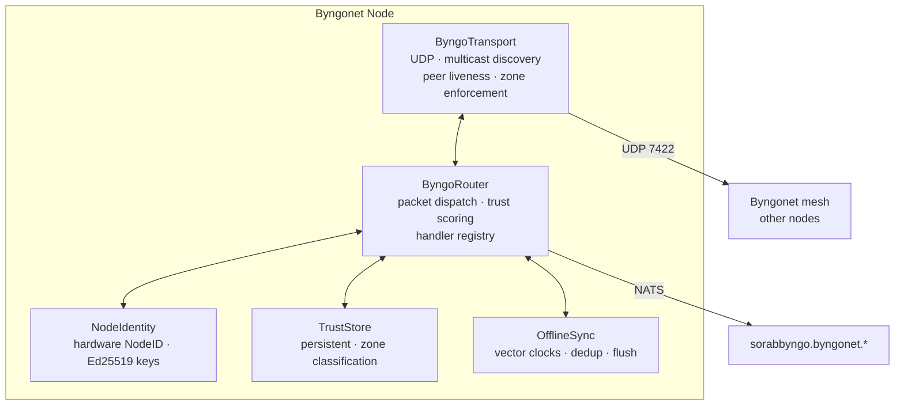

<p align="center">
  
</p>
<p align="center">
  <strong>Byngonet — AI-Native Mesh Network Protocol</strong><br/>
  Connects every Sorabbyngo device into an intelligent mesh
</p>
<p align="center">
  
  
  
  
</p>

---

Byngonet is the AI-native mesh networking layer of SORABBYNGO OS. Every device — phone, clinic workstation, drone, server — is a Byngonet node. Nodes discover each other, establish trust, share intelligence, and sync offline data using AISP (AI Intelligence Sharing Protocol).

---

## Architecture



---

## Protocol — AISP

Every packet carries identity, type, payload, and Ed25519 signature.

| Field | Description |
|---|---|
| `packet_id` | UUID — dedup and replay prevention |
| `packet_type` | `AI_TASK` · `AI_RESULT` · `AI_KNOW` · `AI_SYNC` · `AI_PROBE` |
| `sender_node_id` | Hardware-bound NodeID |
| `target_node_id` | Destination node or `*` for broadcast |
| `zone` | `PUBLIC` · `TRUSTED` · `PERSONAL` |
| `payload` | JSON — arbitrary intelligence data |
| `signature` | Ed25519 over packet content |
| `timestamp` | Unix epoch — expiry enforcement |

---

## Trust zones

| Score | Zone | Access |
|---|:---:|---|
| 0.0–0.69 | `PUBLIC` | Probe and discovery only |
| 0.7–0.99 | `TRUSTED` | Full mesh participation |
| 1.0 | `PERSONAL` | All subjects including PRIME |

---

## Quick start

```bash
# Start a node
python3 byngonet_node.py --node-id=$(cat /proc/sorabbyngo/nodeid)

# Run tests
pytest tests/ -v  # 99 passing
```

---

## Part of SORABBYNGO OS

| Repo | Role |
|---|---|
| [security](https://github.com/sorabbyngo-Labs/security) | 7-ring defence |
| [dmz](https://github.com/sorabbyngo-Labs/dmz) | PRIME zone isolation |
| [identity-core](https://github.com/sorabbyngo-Labs/identity-core) | SUID + NodeID |
| [sorabbyngo-cyberwall](https://github.com/sorabbyngo-Labs/sorabbyngo-cyberwall) | Security layer |

---

<p align="center">
  <strong>Sorabbyngo Company</strong> &nbsp;·&nbsp; Kisii, Kenya &nbsp;·&nbsp; 2026<br/>
  <em>Rhythm of Digital Life</em>
</p>
