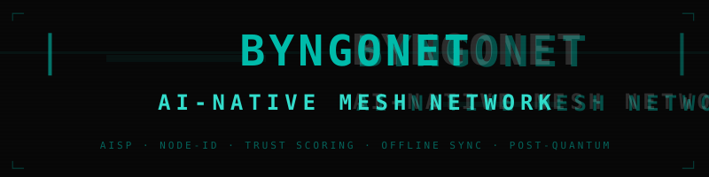

<p align="center">
  
</p>

<h1 align="center">
Byngonet
</h1>

<p align="center">
 Distributed Networking Stack for Sorabbyngo OS
</p>

<p align="center">

Mesh Networking • Secure Transport • Device Discovery • Offline Sync • Remote Execution Transport

</p>

---

# Overview

Byngonet is the networking foundation of the Sorabbyngo ecosystem.

Unlike conventional networking libraries, Byngonet is designed specifically for AI-native operating systems. It provides secure communication between Sorabbyngo devices while remaining completely independent from reasoning and intelligence.

Byngonet does **not** make decisions.

Byngonet **moves information**.

Reasoning is performed by **Byngox**.

Execution is performed by **AION** inside Chameha.

---

# Position inside Sorabbyngo

```
                User
                  │
             Chameha
                  │
               AION
                  │
              Byngox
                  │
      ┌───────────┴────────────┐
      │                        │
 Capability Broker        Byngonet
      │                        │
      │                  Network Layer
      │                        │
      └───────────┬────────────┘
                  │
                 HAL
                  │
             Linux Kernel
                  │
              Hardware
```

---

# Responsibilities

Byngonet is responsible for

- Mesh networking

- Device discovery

- Peer authentication

- Encrypted communication

- Offline synchronization

- Session establishment

- Transport abstraction

- Network quality monitoring

- Remote messaging

- Remote command transport

- Relay services

- NAT traversal

- Connection recovery

- Service discovery

- Cluster formation

- Secure tunnels

- Distributed state synchronization

---

# Not Responsible For

Byngonet **does not**

- Perform AI reasoning

- Execute hardware actions

- Interpret user requests

- Manage permissions

- Control devices

Those responsibilities belong to

- Chameha

- AION

- Byngox

- Capability Broker

---

# Remote Control Flow

```
Desktop

↓

Chameha

↓

AION

↓

Byngox (Planning)

↓

Byngonet

========================

Encrypted Transport

========================

↓

Phone

↓

Byngonet

↓

Capability Broker

↓

HAL

↓

Kernel

↓

Hardware
```

Byngonet transports requests only.

The receiving device validates permissions before execution.

---

# Major Components

```
network/

    discovery/
    routing/
    transport/
    mesh/
    sync/
    security/
    relay/
    tunnel/
    telemetry/
```

---

# Features

## Mesh Networking

Automatic peer discovery.

---

## Device Discovery

Find nearby Sorabbyngo devices.

---

## Offline Synchronization

Synchronize data without Internet.

---

## Transport Layer

Reliable encrypted messaging.

---

## Remote Sessions

Desktop ↔ Phone

Phone ↔ Desktop

Desktop ↔ Desktop

Phone ↔ Phone

---

## Network Telemetry

Latency

Bandwidth

Packet loss

Signal quality

Route health

---

## Service Discovery

Locate services running across devices.

---

## Security

Mutual authentication

Encrypted channels

Replay protection

Session expiration

Forward secrecy

---

# Future

Byngonet will eventually support

- WiFi Direct

- Bluetooth Mesh

- Ethernet

- LAN

- Internet

- Satellite

- LoRa

- NFC handoff

- Multi-path networking

- Swarm communication

---

# Related Projects

| Repository | Responsibility |
|------------|----------------|
| Chameha | Personality AI |
| Byngox | Multi-agent reasoning |
| HAL | Hardware abstraction |
| Sorabbyngo Base | Operating system |
| Capability Broker | Permission enforcement |

---

# Philosophy

Byngonet exists for one purpose.

Move information securely, reliably, and efficiently.

Nothing more.

Nothing less.
